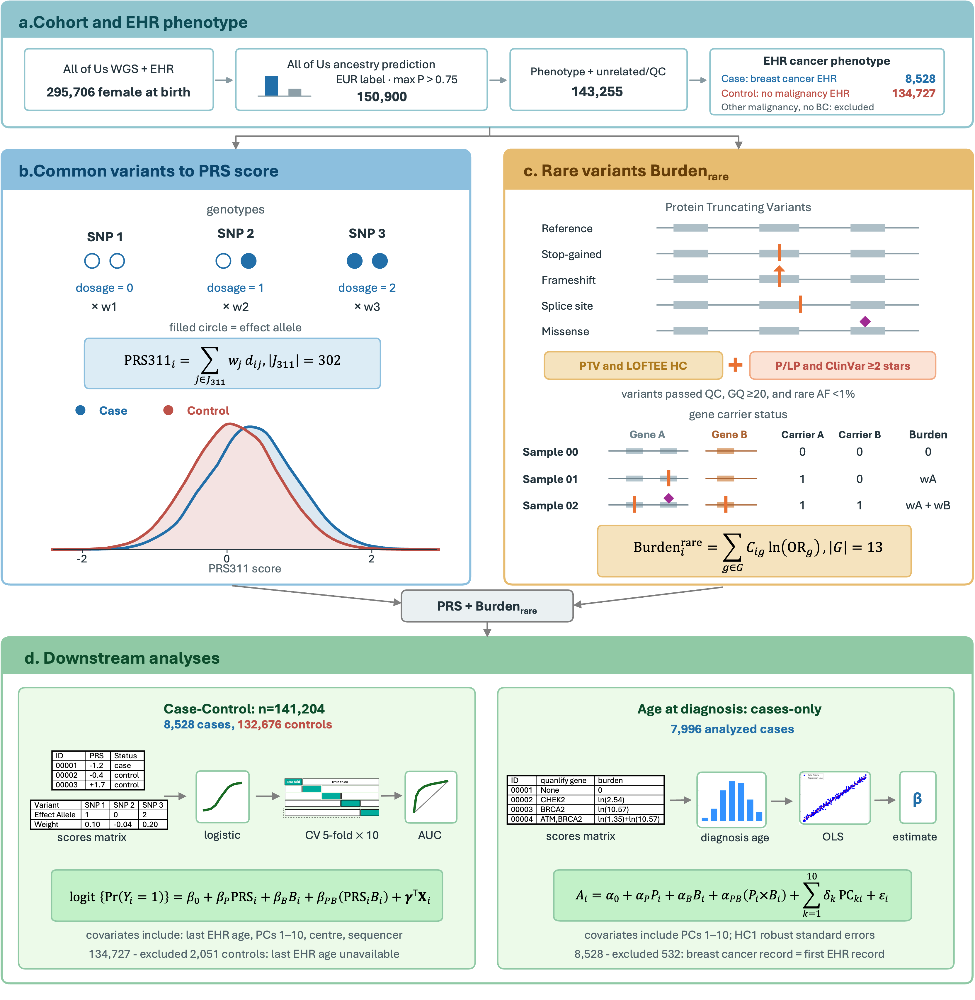

# Rare variant burden complements polygenic risk in breast cancer diagnosis and is associated with earlier diagnosis

**Preprint:** [Read on medRxiv](https://www.medrxiv.org/content/10.64898/2026.10.17.26365799v1) · Version 1

*Figure 1. Study cohort, polygenic risk scoring, rare-variant burden construction, and downstream analyses.*

This repository provides public analysis code accompanying the preprint. See [TUTORIAL.md](TUTORIAL.md) for the workflow and usage instructions.

## Overview

This study uses whole-genome sequencing and electronic health records from the All of Us Research Program to examine the independent and joint associations of common polygenic susceptibility and rare germline variation with breast cancer case status and recorded age at diagnosis among cases. Common variation is summarized by PRS311, and rare variation by a weighted burden score across 13 breast cancer susceptibility genes, including protein-truncating variants and qualifying pathogenic/likely pathogenic missense variants. PRS311 is derived from the BCAC score and contains 302 scored loci after excluding two CHEK2-tagging variants to reduce double counting.

The study includes participants recorded as female at birth with genetically inferred European ancestry. After quality control, the cohort comprised **8,528 breast cancer cases and 134,727 controls**. Case-status models included **141,204 participants**, and the diagnosis-age analysis included **7,996 cases**.

## Main findings

- **Common and rare variants provide complementary information about case status.** In the joint model, the odds ratios (ORs) per standard deviation were **1.55** for PRS311 and **1.27** for rare-variant burden, each evaluated at the other score's mean. Cross-validated AUC increased from **0.745** for covariates alone to **0.782** after adding both genetic scores and their interaction.
- **The joint association is submultiplicative.** The PRS × rare-variant burden interaction OR was **0.972**, with a weaker relative PRS association among carriers. This statistical interaction on the odds-ratio scale does not establish biological antagonism.
- **Rare-variant burden has a stronger association with earlier recorded diagnosis.** Among cases, each standard deviation increase in burden and PRS311 was associated with diagnosis **1.82 years** and **0.43 years** earlier, respectively. Together, the scores explained **2.63%** of the variation in recorded diagnosis age.
- **Rare-variant carriers are more frequent among cases diagnosed at younger ages.** Carrier frequency declined from **26.5%** among cases diagnosed before age 35 to **3.2%** among those diagnosed at age 70 or older.

These findings support considering common and rare inherited variation together and suggest different genetic association patterns for case status and recorded diagnosis age. Interpretation is limited by uncertainty in EHR-derived diagnosis dates, restriction to European ancestry, post hoc components of the expanded analyses, and pending final manual variant adjudication. AUC includes contributions from age and the observation window, so increments between models are more informative than absolute AUC. The findings do not establish prospective absolute-risk prediction or causal effects.

## Methods and analysis

The workflow covers cohort selection and quality control, PRS construction, rare-variant annotation and burden scoring, joint logistic models of case status, repeated five-fold cross-validation, and case-only diagnosis-age regression. Sensitivity and exploratory interaction analyses assess robustness. Numbered scripts and shared helpers are located in the repository root and `functions/`.

For setup, configuration, stage-by-stage methods, and data-handling guidance, see [TUTORIAL.md](TUTORIAL.md). Participant-level data are not included; execution requires authorized access to the source data.
