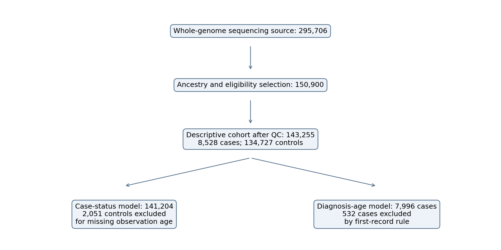
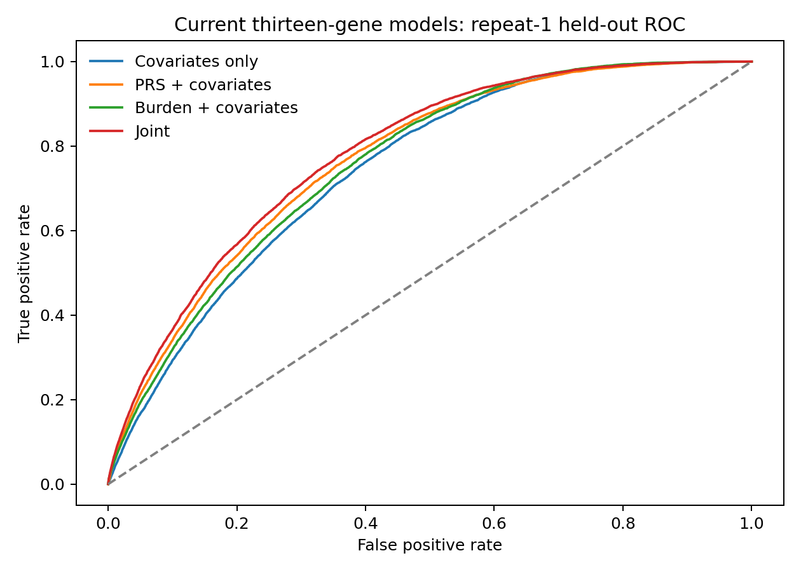
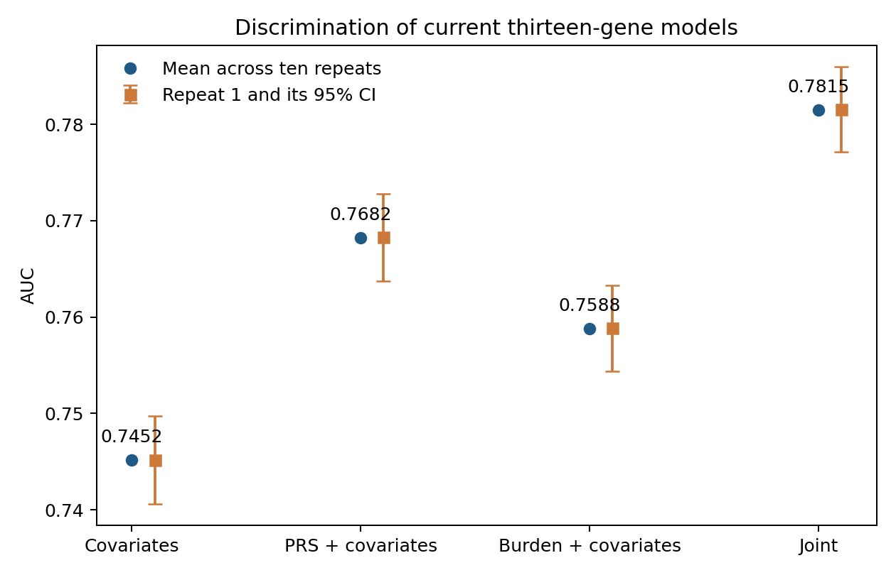
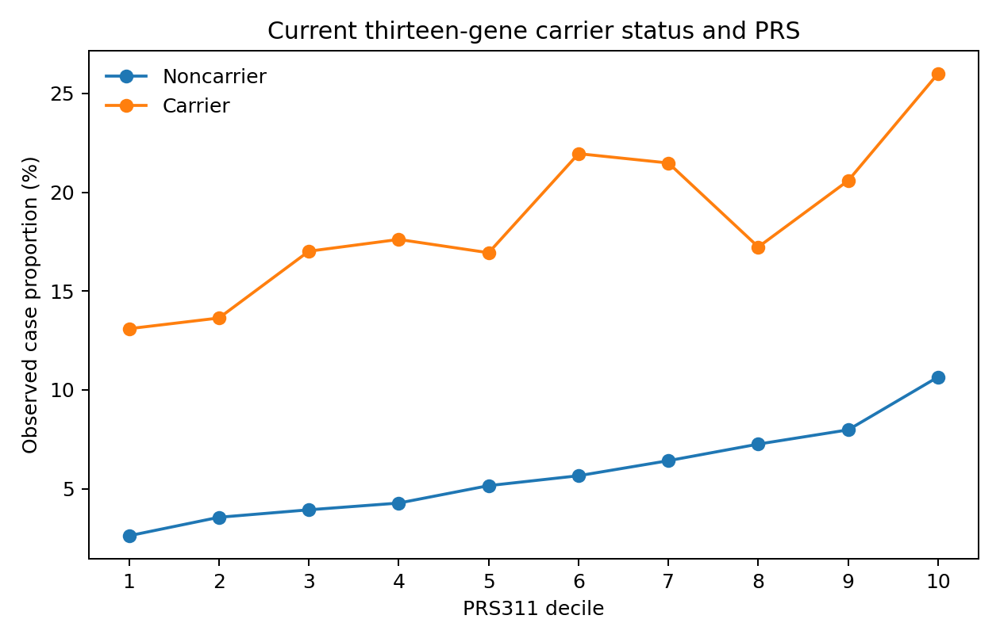
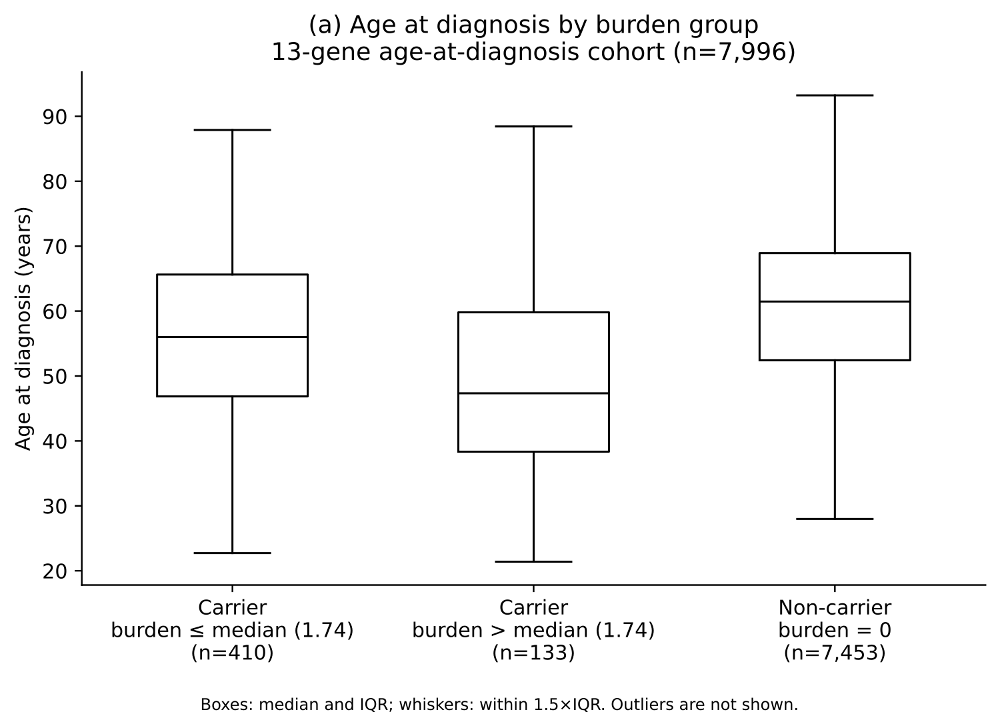
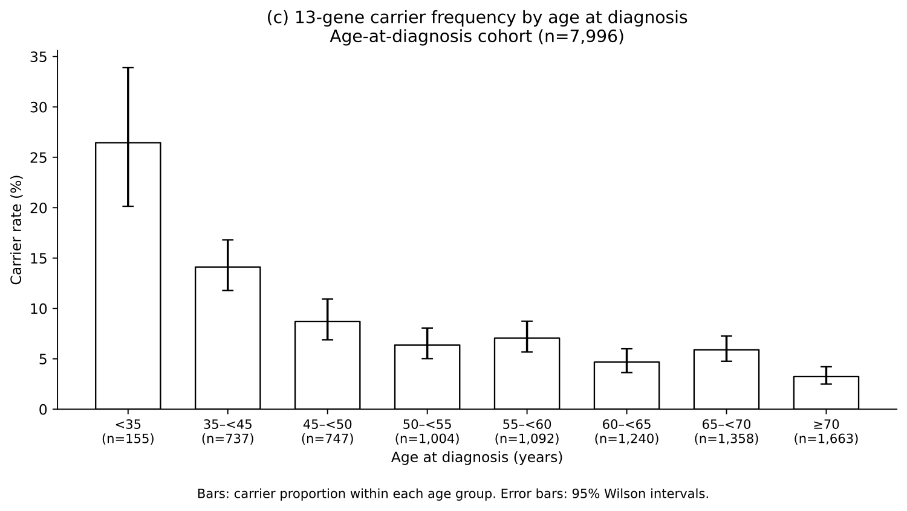

# Common- and rare-variant genetic susceptibility to breast cancer: joint discrimination and recorded diagnosis age

Zimeng Yu1

1Program in Computational Biology and Bioinformatics, Yale University, New Haven, CT 06520 USA.

Corresponding author: [name, address, e-mail]

## Abstract

Common and rare genetic variants contribute to breast cancer susceptibility, but their joint association with case status and recorded diagnosis age requires evaluation in electronic health record cohorts. We studied 8,528 cases and 132,676 controls without recorded cancer of genetically inferred European ancestry in the All of Us Research Program. We combined a common-variant polygenic risk score (PRS), named PRS311 with 302 retained scored loci, and a thirteen-gene burden index based on qualifying protein-truncating variants (PTVs) and eligible pathogenic/likely pathogenic missense variants, weighted by external gene-level log odds ratios. Four logistic models included age, ancestry principal components and sequencing covariates; discrimination was evaluated using ten repeats of five-fold cross-validation. In the joint model, the odds ratios per standard deviation were 1.554 (95% confidence interval, 1.518–1.591) for PRS and 1.269 (1.251–1.287) for burden, conditional on the other predictor at its mean. Their multiplicative-odds interaction was negative (interaction odds ratio, 0.972; 0.958–0.985; P=6.0×10⁻⁵). Mean areas under the receiver operating characteristic curve were 0.7452 for covariates alone, 0.7682 with PRS, 0.7588 with burden, and 0.7815 for the joint model; the joint-versus-PRS increment was 0.01328. Among 7,996 cases with eligible diagnosis-age records, each standard-deviation increase in PRS and burden was associated with 0.43 (0.18–0.68) and 1.82 (1.53–2.11) years younger recorded diagnosis age, respectively. The age model explained 2.63% of variation. The thirteen-gene burden added modest discrimination beyond PRS and associated with younger recorded diagnosis age among cases. These findings do not establish biological antagonism, prospective risk calibration or clinical utility; variant adjudication remains incomplete.

## Introduction

Breast cancer susceptibility reflects both common genetic variation and rarer variants in susceptibility genes. Common-variant polygenic risk scores (PRSs) summarize many small associations, whereas gene-level studies identify larger associations for selected protein-truncating variants (PTVs) and pathogenic missense variants[1–3]. Variant class and gene context matter: including every missense variant would dilute the distinction between clinical pathogenicity and sequence variation. Rowlands et al. combined population-based evidence across thirteen genes and reported estimates for PTVs together with non-PTV pathogenic variants, providing an external basis for an expanded panel[13].

Studies of pathogenic-variant carriers indicate that common genetic background can modify breast cancer susceptibility[4–8]. These observations motivate joint modeling, but improved discrimination does not by itself establish a statistical interaction, and a logistic interaction concerns multiplicative odds rather than an additive absolute-risk scale. Gene-specific differences may also be concealed by a pooled burden index.

The All of Us Research Program links genomic data with electronic health records (EHRs), enabling assessment in a health care cohort[9,10]. We evaluated separate and joint associations of PRS and a thirteen-gene PTV plus eligible pathogenic/likely pathogenic missense burden with breast cancer case status, incremental discrimination beyond PRS and covariates, and recorded diagnosis age among cases. The main paper uses this single burden definition; historical score comparisons are reported separately in the supplement.

## Methods

Study population. We used controlled-tier All of Us data release C2025Q4R6. The analysis selected participants recorded as female, with genetically inferred European ancestry (maximum ancestry posterior probability >0.75), and retained an unrelated set using KING kinship >0.1 to identify related pairs[11]. Participants with missing genotype rates >3% in an approximately 1,500-locus chromosome-21 proxy were excluded; this was not a genome-wide missingness measurement. Cohort selection and the distinction between the descriptive and fitted-model cohorts are shown in Figure 1 and Table 1.

Phenotypes. Cases had an EHR breast cancer diagnosis within the SNOMED breast cancer concept 4112853 and its descendants. Controls had neither a coded breast cancer diagnosis nor a coded diagnosis in the project’s any-cancer exclusion set. Controls were not required to be free of benign breast disease, other illnesses or breast cancer family history. Absence of a recorded diagnosis does not confirm absence of disease. Recorded diagnosis age was age at the earliest qualifying breast cancer code. The observation-age covariate was the later of the last clinical EHR date and death date, where available. We excluded 2,051 controls with missing observation age from case-status models. The diagnosis-age analysis excluded 532 cases whose first breast cancer record coincided with their first EHR record; this rule does not establish incident disease.

Common-variant score. We implemented the overall breast cancer score PGS000004 from the Polygenic Score Catalog[1,12] on GRCh38. Of 313 intended loci, 304 were resolved (281 direct matches and 23 frequency-resolved matches); eight were unmatched and one remained unresolved. Excluding two CHEK2 tagging loci left 302 scored loci in the score named PRS311. Allele dosages were multiplied by the published weights and summed; missing dosage was replaced using the cohort mean dosage. The name denotes the intended score after tag exclusions, not the number of successfully scored loci. Harmonization details are in Supplementary Methods.

Thirteen-gene panel and variant eligibility. The panel comprised ATM, BARD1, BRCA1, BRCA2, CHEK2, PALB2, RAD51C, RAD51D, TP53, CDH1, NF1, PTEN and STK11[13]. A PTV required a stop-gained, frameshift, splice-donor or splice-acceptor consequence and a high-confidence loss-of-function annotation from the Loss-of-Function Transcript Effect Estimator (LOFTEE)[14] on the same retained transcript of the same gene. Any qualifying retained transcript could establish eligibility; the analysis was not restricted to canonical transcripts and did not implement a blanket final-exon exclusion. Eligible missense variants required germline pathogenic or likely pathogenic classification, ClinVar review status of at least two stars, and applicable disease and inheritance evidence. Low-penetrance, risk-factor/risk-allele, conflicting or opposing benign assertions, and records held out for unresolved eligibility were excluded. ClinVar release 2026-09-13 was used. Clinical classification and loss-of-function interpretation require disease and transcript context[16,18]; detailed rules are provided in Supplementary Methods.

Genotype quality control. Both variant classes required a known, consistent All of Us European allele frequency <0.01 and a valid normalized-allele match. Original variant-dataset site filters had to be defined-empty or singleton PASS; genotype filters had to use the accepted PASS or “.” encoding. Genotype quality was ≥20. The target alternative-allele fraction, calculated as its allele depth divided by the sum of all allelic depths, had to be 0.30–0.80 for heterozygotes and ≥0.80 for homozygous alternative genotypes. Missing required quality fields did not pass. The analysis did not adopt a separate depth ≥10 requirement: the queried genotype extract did not provide the corresponding depth field, and summed allelic depth was not treated as that field.

Burden calculation. For participant i, Bᵢ = Σg∈G₁₃ ln(ORg) Cᵢg, where Cᵢg=1 for at least one qualifying PTV or eligible pathogenic/likely pathogenic missense variant in gene g and 0 otherwise. Multiple qualifying variants within a gene contributed once; variants in different genes contributed separately. We used Rowlands Table 2 combined PTV plus non-PTV pathogenic-variant odds ratios as approximate external gene-level weights[13] (Supplementary Table S1). Those source variant definitions differ from ours, so the sum is a burden index rather than an individually calibrated risk estimate. No allele- or variant-count dosage effect was assumed.

Case-status analysis. Logistic regression compared covariates alone, PRS plus covariates, burden plus covariates, and a joint model with both predictors and their product. Covariates were observation age, ancestry principal components (PCs) 1–10, sequencing center and sequencer. Genetic predictors were standardized using means and sample standard deviations (SDs) in the fitted-model cohort. The joint model was logit Pr(caseᵢ)=α+βP Pᵢ+βB Bᵢ+βPB PᵢBᵢ+γᵀXᵢ, where P and B are standardized predictors. Main genetic effects are conditional on the other predictor being zero, its cohort mean. HC1 heteroscedasticity-robust standard errors were used; odds ratios (ORs) are exponentiated coefficients with 95% confidence intervals (CIs).

Discrimination. We used ten repeats of stratified five-fold cross-validation (CV), with score standardization learned in each training fold. The area under the receiver operating characteristic curve (AUC) was calculated from held-out predictions for each repeat. Mean repeated-CV AUC is reported separately from repeat-1 AUC and its confidence interval. Paired DeLong intervals and tests[15] used matched held-out predictions within a repeat. Averaging interval endpoints across repeats was not interpreted as a confidence interval for the mean. The principal discrimination contrast was the joint model versus PRS plus covariates; it does not isolate the contribution of the product term.

Recorded diagnosis age. Ordinary least squares regression among eligible cases included continuous PRS, burden and PCs 1–10, with HC1 robust standard errors. Both genetic predictors were standardized within this case cohort using sample SDs. We reported coefficients in years per SD, R² and the increment in R² after adding burden to the PRS-plus-PC model. This analysis concerns recorded diagnosis age conditional on being a case, rather than prospective onset or time to disease.

Sensitivity analyses and chronology. Score sensitivities excluded STK11, used PTVs alone, tightened the heterozygous upper allele-fraction bound to 0.70 for TP53 and NF1, allowed ClinVar one-star eligible missense variants, or excluded CDH1. These specifications were locked before evaluation of the current thirteen-gene associations, after earlier burden analyses had been conducted. Selection of this score as the sole main analysis does not imply original study-wide prespecification. The variant-definition records remain provisional pending final adjudication. A subsequent exploratory interaction audit assessed influence, binary carrier status, nonlinear PRS and age terms, gene heterogeneity, and EHR coverage. Seven gene-category interaction tests used Benjamini–Hochberg adjustment; other audit P values were nominal. Details appear in Supplementary Tables S7–S8.

Reproducibility and disclosure. Analyses used Hail, PLINK 2[17], pandas, statsmodels and scikit-learn. Only aggregate outputs meeting project disclosure rules were included; small cells below 20 and secondary cells enabling their reconstruction were suppressed. We retained separate denominators for the descriptive cohort, fitted case-status cohort and diagnosis-age cohort.

## Results

Study cohort. Cohort selection began with 295,706 participants with whole-genome sequencing, retained 150,900 participants after ancestry and eligibility selection, and yielded 143,255 after cohort quality control: 8,528 cases and 134,727 controls. The case-status models included 141,204 participants after excluding 2,051 controls with missing observation age. Table 1 describes the larger cohort; 7,996 cases were eligible for diagnosis-age analysis. In the fitted case-status cohort, 3,209 participants (2.27%) carried a qualifying panel variant; 543 diagnosis-age cases (6.79%) were carriers. Cases had mean recorded diagnosis age 59.9 years (SD 11.8), and mean enrollment age was 64.0 years in cases versus 51.2 years in controls.

Case-status associations. In the joint model, the OR per SD was 1.554 (95% CI, 1.518–1.591) for PRS and 1.269 (1.251–1.287) for burden, conditional on the other predictor at its mean. The interaction coefficient was −0.0289 (interaction OR, 0.972; 0.958–0.985; P=6.0×10⁻⁵), indicating a negative departure from multiplicative odds (Table 2). This coefficient does not show that carriers have a lower overall breast cancer association.

Incremental discrimination. Mean repeated-CV AUCs were 0.7452 for covariates alone, 0.7682 for PRS plus covariates, 0.7588 for burden plus covariates, and 0.7815 for the joint model (Table 2; Figure 2). The mean joint-versus-PRS increment was 0.01328. For repeat 1, the paired increment was 0.01328 (95% CI, 0.01133–0.01523; P=1.68×10⁻⁴⁰). Repeat-specific results and historical score comparisons appear in Supplementary Tables S3–S5. These results quantify discrimination in the selected cohort and do not establish prospective absolute-risk calibration.

Joint distribution. Observed case proportions were displayed across PRS deciles separately for carriers and noncarriers of qualifying thirteen-gene variants (Figure 3). This descriptive display uses case counts divided by participants within each decile–carrier cell. It is not an age-standardized risk estimate or a prospective penetrance curve; the marked age difference between cases and controls should be considered when interpreting it.

Recorded diagnosis age. In 7,996 cases, PRS was associated with −0.43 years per SD (95% CI, −0.68 to −0.18; P=7.50×10⁻⁴) and burden with −1.82 years per SD (−2.11 to −1.53; P=1.55×10⁻³⁵). The joint age model had R²=0.02628 and adjusted R²=0.02481. Adding burden to PRS and PCs increased R² by 0.02366, or 2.37 percentage points (Table 3). Burden-group and diagnosis-age carrier distributions are shown in Figure 4. An exploratory binary-carrier-by-PRS age interaction was uncertain: its coefficient was 0.98 years (95% CI, −0.08 to 2.04), which does not establish synergy (Supplementary Table S6).

Sensitivity analyses. Across the five score sensitivities, burden remained associated with case status and younger recorded diagnosis age (Supplementary Table S2). The exploratory interaction audit retained a negative panel-level estimate with binary carrier status (OR, 0.823; 95% CI, 0.744–0.910; P=1.50×10⁻⁴), nonlinear PRS terms (joint interaction P=0.00249), alternative age specifications and EHR coverage adjustment or restriction. Removing the 100 most interaction-influential observations attenuated the coefficient magnitude by approximately 27% (β=−0.0211; nominal P=0.00229). Gene-category interactions differed (heterogeneity P=0.0126); BRCA1 showed the clearest negative estimate (OR, 0.652; 95% CI, 0.514–0.828; adjusted q=0.00301), while BRCA2 did not pass correction (nominal P=0.0217; q=0.0758). Excluding BRCA1 carriers attenuated the pooled interaction (β=−0.0206; nominal P=0.0267). Full results and descriptive gene-specific PRS box plots are in Supplementary Tables S7–S8 and Figure S7.

## Discussion

In this EHR-linked cohort, a thirteen-gene PTV plus eligible pathogenic/likely pathogenic missense burden associated with breast cancer case status and added modest discrimination beyond PRS and covariates. Both predictors associated with younger recorded diagnosis age among cases, but the age model explained only 2.63% of variation. These findings support complementary information from common and qualifying rare variants without establishing that the score predicts calibrated individual risk or improves clinical outcomes.

The burden is continuous because gene carriers receive different external log-OR weights and carriers in multiple genes receive summed contributions. It is not a count of variants within a gene. This distinction preserves externally supported differences between genes without assuming an unvalidated linear dosage effect. Binary carrier status provides a useful robustness analysis, but discards the gene-weight information. Rowlands estimates are approximate weights: its non-PTV pathogenic-variant set and source populations differ from our eligible missense set and selected cohort[13]. STK11 has an imprecise source estimate and CDH1 has subtype-specific associations; the exclusion sensitivities address, but do not eliminate, these concerns.

The negative logistic interaction indicates a weaker joint association than expected under multiplicative odds; it does not demonstrate protection, biological antagonism or an additive absolute-risk interaction. Gene-specific results suggest that heterogeneous PRS associations, including a prominent BRCA1 contribution, may partly explain the pooled result. Barnes et al. found that an estrogen receptor-negative-specific PRS had the strongest breast cancer association in BRCA1 carriers, whereas an overall breast cancer PRS performed best in BRCA2 carriers; carrier-cohort associations were smaller than general-population estimates[5]. This supports tumor-subtype applicability as a hypothesis for our overall breast cancer PRS. We did not evaluate a subtype-specific PRS or establish subtype mediation, and their hazard ratios are not directly comparable with our case-status ORs. Partial attenuation in influence diagnostics, EHR ascertainment, prevalent-case selection and residual model misspecification remain possible contributors. The gene-specific box plots are descriptive and do not establish that carrier status causes a change in PRS.

A prior All of Us analysis did not detect significant diagnosis-age differences using PRS tertiles and Kaplan–Meier/log-rank comparisons[20]. Our continuous PRS model identified a small association of −0.43 years per SD. Greater granularity or efficiency of continuous modeling is a possible explanation, but differences in cohort composition, ancestry, sample size, implementation and covariate adjustment also matter. A difference between significant and nonsignificant results is not itself evidence of a between-study difference. Both analyses use recorded diagnosis age, which may differ from biological onset.

Several limitations constrain interpretation. Cases were older than controls, and EHR coverage, diagnostic practices and selection into the program can affect case and control classification. Controls excluded coded cancers, so results need not generalize to all people without breast cancer. Case-only diagnosis-age analysis can be affected by conditioning on disease[19]; this concern does not prove bias in the present estimate. Blood-derived variants, particularly in TP53 and NF1, may include acquired clonal events despite genotype filters. Predicted loss of function is transcript- and position-dependent, and final manual variant adjudication remains pending; annotation confidence alone is not clinical validation. Score selection followed earlier analyses, and the interaction audit was post hoc. External weights were not individually recalibrated, repeated CV is internal validation, and ancestry restriction limits generalizability. Family-history survey coding and temporal alignment of menopausal status remain separate phenotype-review issues (Table 1); these variables were descriptive and were not model covariates.

The thirteen-gene burden therefore provides modest additional case-status discrimination and an association with younger recorded diagnosis age. Prospective validation, finalized variant adjudication and evaluation of absolute-risk calibration and clinical decision value are needed before individual use.

## Declarations

Acknowledgements. [Insert the All of Us Research Program acknowledgement verbatim from the program’s “How to acknowledge and cite” guidance, including the NIH grant numbers it lists, and thank the participants.]

Data availability. Individual-level data are available to registered researchers through the All of Us Researcher Workbench (controlled tier, CDR C2025Q4R6). Aggregate results that meet the dissemination policy and the analysis code are available at https://github.com/martina-yu/AoU_Comr.

Ethics. [Statement on All of Us IRB oversight and participant consent.]

Funding. [Funders and grant numbers.]

Competing interests. [To be completed.]

Author contributions. [To be completed.]

## References

1. Mavaddat N, Michailidou K, Dennis J, et al. Polygenic risk scores for prediction of breast cancer and breast cancer subtypes. Am J Hum Genet. 2019;104(1):21–34.

2. Breast Cancer Association Consortium; Dorling L, Carvalho S, Allen J, et al. Breast cancer risk genes—association analysis in more than 113,000 women. N Engl J Med. 2021;384(5):428–439.

3. Hu C, Hart SN, Gnanaolivu R, et al. A population-based study of genes previously implicated in breast cancer. N Engl J Med. 2021;384(5):440–451.

4. Kuchenbaecker KB, McGuffog L, Barrowdale D, et al. Evaluation of polygenic risk scores for breast and ovarian cancer risk prediction in BRCA1 and BRCA2 mutation carriers. J Natl Cancer Inst. 2017;109(7):djw302.

5. Barnes DR, Rookus MA, McGuffog L, et al. Polygenic risk scores and breast and epithelial ovarian cancer risks for carriers of BRCA1 and BRCA2 pathogenic variants. Genet Med. 2020;22(10):1653–1666. doi:10.1038/s41436-020-0862-x.

6. Gallagher S, Hughes E, Wagner S, et al. Association of a polygenic risk score with breast cancer among women carriers of high- and moderate-risk breast cancer genes. JAMA Netw Open. 2020;3(7):e208501.

7. Fahed AC, Wang M, Homburger JR, et al. Polygenic background modifies penetrance of monogenic variants for tier 1 genomic conditions. Nat Commun. 2020;11(1):3635.

8. Mars N, Widén E, Kerminen S, et al. The role of polygenic risk and susceptibility genes in breast cancer over the course of life. Nat Commun. 2020;11(1):6383.

9. The All of Us Research Program Investigators. The “All of Us” Research Program. N Engl J Med. 2019;381(7):668–676.

10. The All of Us Research Program Genomics Investigators. Genomic data in the All of Us Research Program. Nature. 2024;627(8003):340–346.

11. Manichaikul A, Mychaleckyj JC, Rich SS, Daly K, Sale M, Chen WM. Robust relationship inference in genome-wide association studies. Bioinformatics. 2010;26(22):2867–2873.

12. Lambert SA, Gil L, Jupp S, et al. The Polygenic Score Catalog as an open database for reproducibility and systematic evaluation. Nat Genet. 2021;53(4):420–425.

13. Rowlands CF, et al. Population-based germline breast cancer gene association studies and meta-analysis to inform wider mainstream testing. Ann Oncol. 2024;35(10):892–901. doi:10.1016/j.annonc.2024.07.244.

14. Karczewski KJ, Francioli LC, Tiao G, et al. The mutational constraint spectrum quantified from variation in 141,456 humans. Nature. 2020;581(7809):434–443.

15. DeLong ER, DeLong DM, Clarke-Pearson DL. Comparing the areas under two or more correlated receiver operating characteristic curves: a nonparametric approach. Biometrics. 1988;44(3):837–845.

16. Richards S, Aziz N, Bale S, et al. Standards and guidelines for the interpretation of sequence variants: a joint consensus recommendation of the American College of Medical Genetics and Genomics and the Association for Molecular Pathology. Genet Med. 2015;17(5):405–424. doi:10.1038/gim.2015.30.

17. Chang CC, Chow CC, Tellier LC, Vattikuti S, Purcell SM, Lee JJ. Second-generation PLINK: rising to the challenge of larger and richer datasets. GigaScience. 2015;4:7.

18. Abou Tayoun AN, Pesaran T, DiStefano MT, et al. Recommendations for interpreting the loss of function PVS1 ACMG/AMP variant criterion. Hum Mutat. 2018;39(11):1517–1524. doi:10.1002/humu.23626.

19. Dudbridge F, Allen RJ, Sheehan NA, et al. Adjustment for index event bias in genome-wide association studies of subsequent events. Nat Commun. 2019;10:1561. doi:10.1038/s41467-019-09381-w.

20. Guare LA, Das J, Caruth L, Setia-Verma S. Social determinants of health and lifestyle risk factors modulate genetic susceptibility for women’s health outcomes. Pac Symp Biocomput. 2025;30:296–313. doi:10.1142/9789819807024_0022.

## Tables

## Table 1. Descriptive cohort characteristics.

| Characteristic                                | Cases            | Controls       | Diagnosis-age cases    |
|:----------------------------------------------|:-----------------|:---------------|:-----------------------|
| N                                             | 8,528            | 134,727        | 7,996                  |
| Age at diagnosis, years, mean (SD)            | 59.9 (11.8)      | —              | 60.2 (11.8)            |
| Age at diagnosis, years, median [IQR]         | 60.7 [51.5-68.4] | —              | 61.1 [51.9-68.7]       |
| Age at enrollment, years, mean (SD)           | 64.0 (11.6)      | 51.2 (16.8)    | 64.1 (11.6)            |
| Age at observation endpoint, years, mean (SD) | 68.1 (11.7)      | 53.9 (17.0)    | 68.2 (11.7)            |
| BMI, kg/m2, mean (SD)                         | 28.5 (6.7)       | 29.4 (7.9)     | 28.5 (6.8)             |
| PRS311 (raw score), mean (SD)                 | 0.4 (0.6)        | 0.1 (0.6)      | 0.4 (0.6)              |
| BMI missing, n (%)                            | 92 (1.1)         | 5,107 (3.8)    | suppressed (secondary) |
| Age at observation endpoint missing, n (%)    | 0 (0.0)          | 2,051 (1.5)    | 0 (0.0)                |
| Menopausal status, n (%)                      | —                | —              | —                      |
| Premenopausal                                 | 620 (7.3)        | 49,735 (36.9)  | 592 (7.4)              |
| Postmenopausal                                | 7,610 (89.2)     | 75,983 (56.4)  | 7,133 (89.2)           |
| Uncertain or unknown                          | 149 (1.7)        | 4,801 (3.6)    | suppressed (secondary) |
| Missing                                       | 149 (1.7)        | 4,208 (3.1)    | suppressed (secondary) |
| Coded family history of breast cancer         | —                | —              | —                      |
| Positive (captured affected relatives)        | 2,392 (28.0)     | 25,689 (19.1)  | 2,236 (28.0)           |
| No affected relative coded                    | 3,393 (39.8)     | 26,004 (19.3)  | 3,188 (39.9)           |
| Missing                                       | 2,743 (32.2)     | 83,034 (61.6)  | 2,572 (32.2)           |
| Smoking status, n (%)                         | —                | —              | —                      |
| Never                                         | 4,932 (57.8)     | 80,136 (59.5)  | 4,612 (57.7)           |
| Former or unknown current smoking status      | 2,974 (34.9)     | 35,699 (26.5)  | 2,796 (35.0)           |
| Current                                       | 442 (5.2)        | 13,614 (10.1)  | suppressed (secondary) |
| Missing                                       | 180 (2.1)        | 5,278 (3.9)    | suppressed (secondary) |
| Self-reported race, n (%)                     | —                | —              | —                      |
| White                                         | 8,117 (95.2)     | 126,790 (94.1) | 7,611 (95.2)           |
| Other, multiple, or not reported              | 411 (4.8)        | 7,937 (5.9)    | 385 (4.8)              |
| Sequencing center, n (%)                      | —                | —              | —                      |
| Broad Institute                               | 4,963 (58.2)     | 79,319 (58.9)  | 4,639 (58.0)           |
| University of Washington                      | 997 (11.7)       | 16,069 (11.9)  | 936 (11.7)             |
| Baylor College of Medicine                    | 2,568 (30.1)     | 39,339 (29.2)  | 2,421 (30.3)           |
| Sequencer, n (%)                              | —                | —              | —                      |
| NovaSeq6000 S4                                | 8,293 (97.2)     | 127,580 (94.7) | suppressed (secondary) |
| NovaSeq X 25B                                 | 235 (2.8)        | 7,147 (5.3)    | suppressed (secondary) |

Percentages use each column’s full N, including missing categories: 8,528 cases, 134,727 controls and 7,996 diagnosis-age cases. The case-status fitted-model cohort excludes 2,051 controls with missing observation age and therefore has N=141,204. Observation endpoint is the later available clinical EHR or death date. Menopausal status reflects survey timing rather than necessarily diagnosis timing. Family history is the current coded survey-derived field: absence of an affected-relative code may include skipped or unrecognized responses and is not a validated negative history. Suppression and rounding are retained from the audited source table.

## Table 2. Thirteen-gene case-status associations and discrimination.

| Predictor      |     Beta | OR (95% CI)         |         P |
|:---------------|---------:|:--------------------|----------:|
| PRS, per SD    |  0.44081 | 1.554 (1.518–1.591) | 2.06e-301 |
| Burden, per SD |  0.23787 | 1.269 (1.251–1.287) | 6.93e-233 |
| PRS × burden   | -0.02887 | 0.972 (0.958–0.985) | 6.01e-05  |

| Model               |   Mean CV AUC | Repeat-1 AUC (95% CI)   |
|:--------------------|--------------:|:------------------------|
| Covariates only     |        0.7452 | 0.7452 (0.7406–0.7498)  |
| PRS + covariates    |        0.7682 | 0.7683 (0.7637–0.7728)  |
| Burden + covariates |        0.7588 | 0.7588 (0.7543–0.7633)  |
| Joint               |        0.7815 | 0.7815 (0.7771–0.7859)  |

Association estimates use the joint model with HC1 robust standard errors, observation age, PCs 1–10, sequencing center and sequencer. Main effects are conditional on the other standardized predictor at its mean. Interaction OR is exp(βPRS×burden). Mean AUCs are across ten five-fold CV repeats; displayed CIs belong to repeat 1. Mean joint-versus-PRS ΔAUC=0.01328; repeat-1 paired ΔAUC=0.01328 (95% CI, 0.01133–0.01523).

## Table 3. Recorded diagnosis-age associations among 7,996 cases.

| Predictor      | Years (95% CI)         |        P |
|:---------------|:-----------------------|---------:|
| PRS, per SD    | -0.43 (-0.68 to -0.18) | 0.00075  |
| Burden, per SD | -1.82 (-2.11 to -1.53) | 1.55e-35 |

Predictors are standardized within the diagnosis-age case cohort. The model adjusts for PCs 1–10 and uses HC1 robust standard errors. R²=0.02628; adjusted R²=0.02481; PRS-plus-PC baseline R²=0.002617; adding burden increases R² by 0.02366. These are case-only associations with recorded diagnosis age.

## Figures

Figure 1. Cohort selection and analysis denominators. The case-status and diagnosis-age cohorts are separate branches of the descriptive cohort; the age analysis is restricted to cases.

Figure 2. Discrimination of the four current thirteen-gene models. Receiver operating characteristic curves use repeat-1 held-out predictions; mean AUCs and repeat-1 intervals are reported separately in Table 2. Models include covariates alone, PRS, burden, or both scores and their product.

Figure 3. Observed case proportions across PRS deciles, stratified by qualifying thirteen-gene carrier status. Numerator: cases in the decile–carrier cell; denominator: all participants in that cell. Carrier status is binary even though modeled burden is a weighted continuous index. These unadjusted proportions are not prospective absolute risks.

Figure 4. Recorded diagnosis age by thirteen-gene burden group and carrier frequency by diagnosis-age category. Carrier burden groups use the carrier-median threshold, whose ties can produce unequal group sizes. Carrier frequency is carriers divided by all cases in each eligible age category. These displays concern the 7,996-case diagnosis-age cohort and do not estimate disease incidence.
