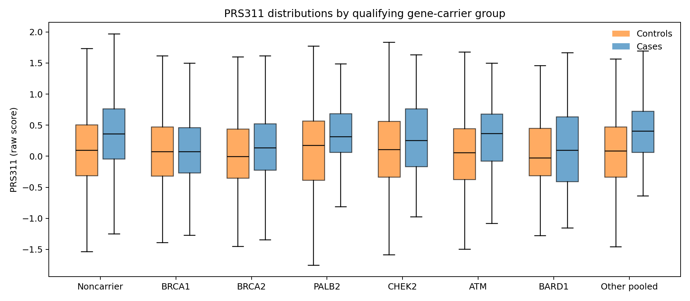
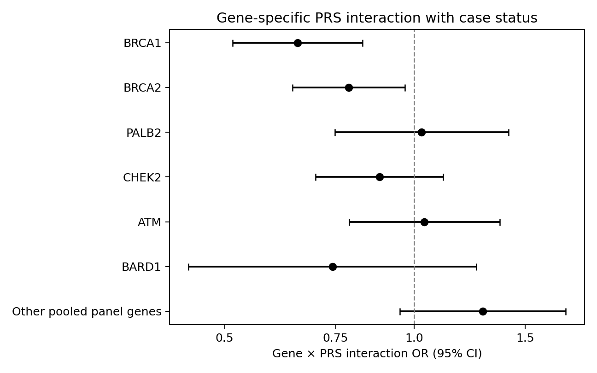
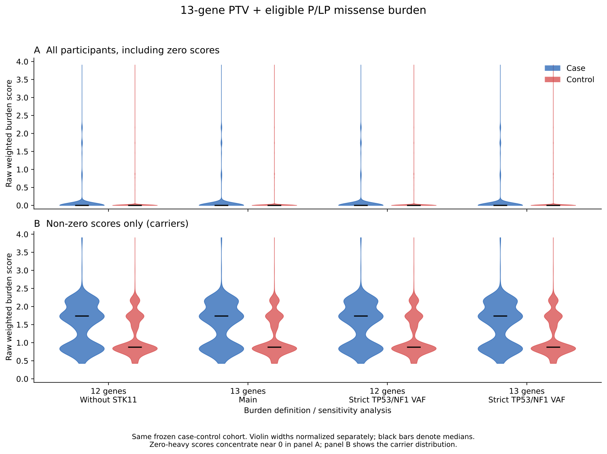
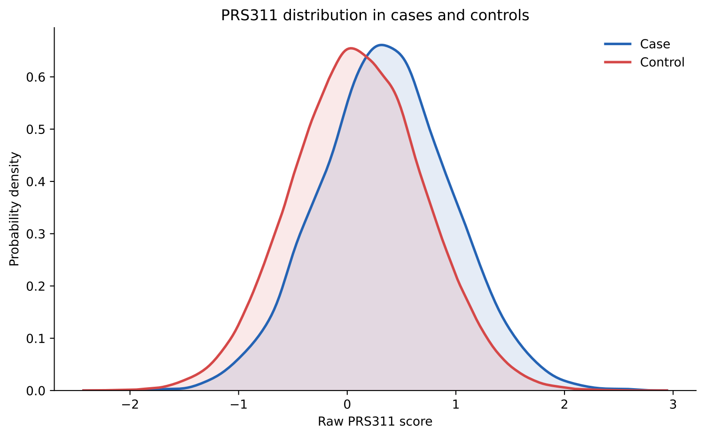
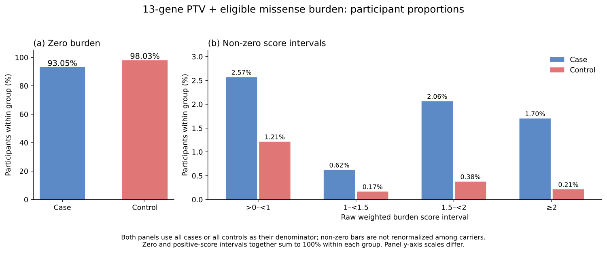
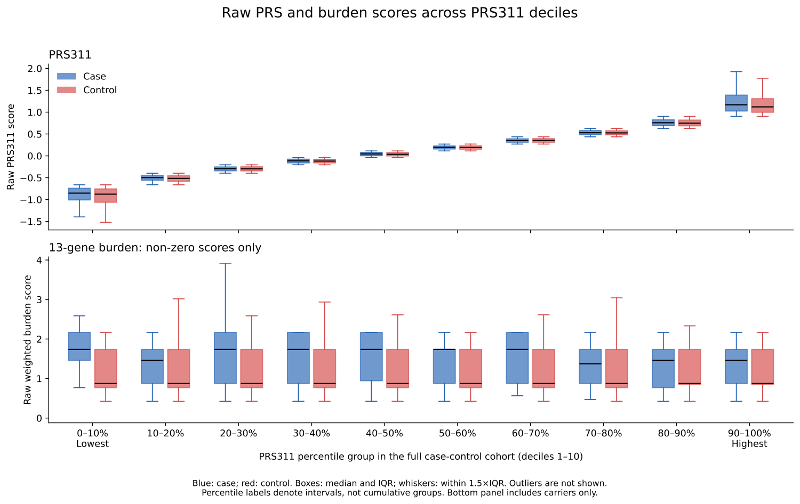
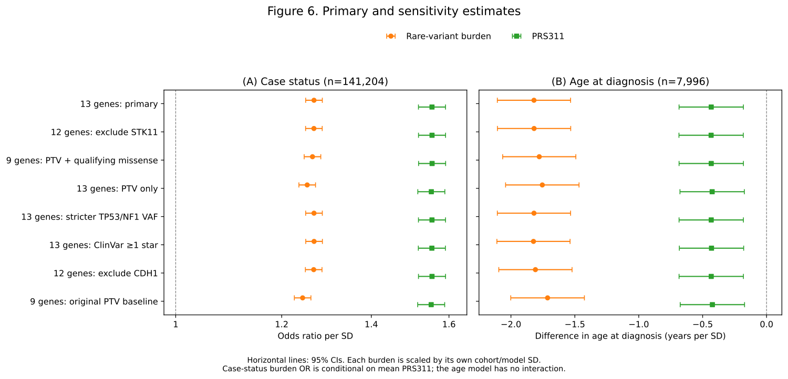
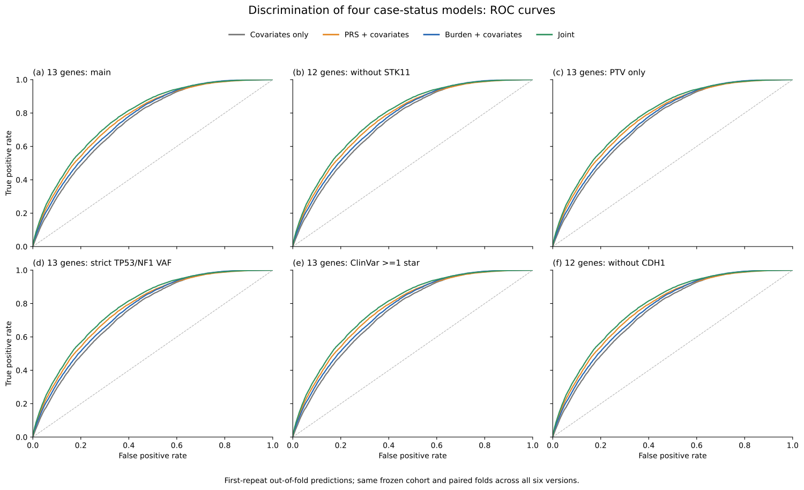
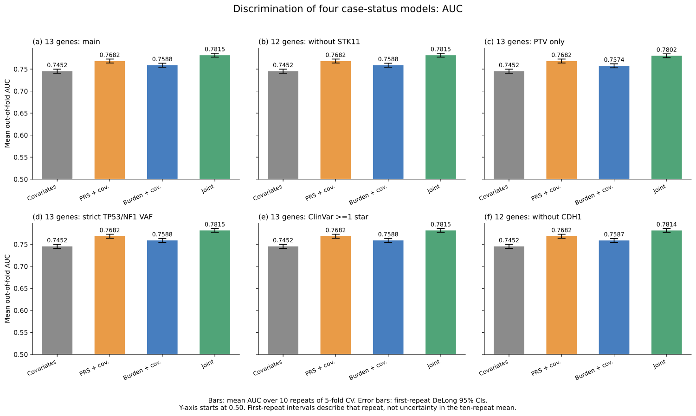

# Supplementary material: thirteen-gene burden revision

Companion to the revised 1006 manuscript. Current-model results and historical comparisons are explicitly separated. Reference numbers refer to the main manuscript.

## Supplementary Methods

Variant procedures follow the rules in the main Methods. PTV consequence and LOFTEE high-confidence status must occur on the same retained transcript for the same gene. Noncanonical retained transcripts can qualify. No blanket final-exon rule was adopted; clinical transcript/position adjudication remains pending. Missense selection uses germline clinical assertions, relevant disease and inheritance context, ≥2-star ClinVar review, and exclusions of low-penetrance, risk alleles, conflicting and opposing benign assertions. Release: 2026-09-13. Unknown or held-out eligibility records are excluded rather than silently assigned to the qualifying set.

Normalized target alleles link annotation to original variant-dataset site and genotype quality. A site passes with defined-empty filters or singleton PASS. Individual genotype filters use PASS or “.”; genotype quality ≥20 is required. Allele fraction uses original target-ALT allele depth divided by total allelic depth, including all alleles. Heterozygotes require 0.30–0.80 and homozygous alternative calls ≥0.80. Missing allele-depth denominators or other required QC fields fail inclusion. Allele frequency must be known and consistent and strictly below 0.01 in the All of Us European population. Summed allele depth was reviewed separately and not substituted for an unavailable genotype depth field. No blanket depth ≥10 rule was adopted.

PRS matching audit: 313 intended loci; 304 matched, including 281 direct and 23 frequency-resolved loci; eight unmatched and one unresolved. Both excluded CHEK2 tags were among the matched loci, yielding 302 retained scored loci in PRS311. Missing locus dosage was imputed with cohort mean dosage. Association models use full fitted-cohort sample-SD standardization; diagnosis-age models use within-case sample-SD standardization. CV uses training-fold means and sample SDs. Saved reference-standardized score files have a different reference scaling and should not be confused with fitted-model scaling.

Interaction audit: influence and leverage deletion, multigene-carrier exclusion, binary carrier status, cubic-spline PRS and age, enrollment-age substitution/restriction and EHR coverage adjustment/restriction used the frozen current case-status cohort. Full-cohort genetic scaling was retained for subset fits. A joint gene-carrier model included gene main effects and PRS-by-gene terms; sparse genes were pooled. HC1 Wald tests evaluated the interaction terms jointly and equality across gene categories. Seven gene-specific tests were adjusted using Benjamini–Hochberg; other P values were nominal. Outcome-dependent influence deletion is diagnostic and does not prove removal of bias.

Chronology and disclosure: historical analyses preceded selection of the thirteen-gene main score. Five score sensitivities were locked before its association evaluation; the interaction audit was later and exploratory. Final biological adjudication is incomplete. Tables and figures contain aggregate data only. Cells below 20 and secondary cells enabling reconstruction are suppressed; sparse gene categories are pooled, and participant identifiers or individual points are not displayed.

## Supplementary Table S1. External thirteen-gene weights.

| Gene   |   External OR |   CI low |   CI high |   ln(OR) |
|:-------|--------------:|---------:|----------:|---------:|
| BRCA1  |          8.73 |     7.47 |     10.2  | 2.16677  |
| BRCA2  |          5.68 |     5.13 |      6.3  | 1.73695  |
| PALB2  |          4.3  |     3.68 |      5.03 | 1.45862  |
| CHEK2  |          2.4  |     2.21 |      2.62 | 0.875469 |
| ATM    |          2.16 |     1.93 |      2.41 | 0.770108 |
| BARD1  |          2.34 |     1.85 |      2.97 | 0.850151 |
| RAD51C |          1.53 |     1.15 |      2.04 | 0.425268 |
| RAD51D |          1.76 |     1.29 |      2.41 | 0.565314 |
| TP53   |          3.62 |     1.98 |      6.61 | 1.28647  |
| PTEN   |          2.63 |     1.38 |      5.02 | 0.966984 |
| NF1    |          2.01 |     1.43 |      2.83 | 0.698135 |
| STK11  |          1.6  |     0.48 |      5.3  | 0.470004 |
| CDH1   |          2.01 |     1.25 |      3.24 | 0.698135 |

Source: Rowlands et al.[13], Table 2 combined PTV plus non-PTV pathogenic-variant column. These are approximate external gene weights, because the source variant set differs from current eligible missense variants. STK11 OR=1.60 (95% CI, 0.48–5.30) is imprecise; CDH1 associations differ by tumor subtype. The score counts each qualifying gene once and does not encode variant or allele dosage.

## Supplementary Table S2. Current-panel score sensitivities.

| cohort        | version                           | term     |   estimate |    CI_low |   CI_high |
|:--------------|:----------------------------------|:---------|-----------:|----------:|----------:|
| case_control  | Main thirteen-gene score          | burden_z |   1.26854  |  1.25052  |  1.28682  |
| case_control  | Exclude STK11                     | burden_z |   1.26833  |  1.25032  |  1.28661  |
| case_control  | PTVs only                         | burden_z |   1.25384  |  1.23605  |  1.27189  |
| case_control  | TP53/NF1 stricter allele fraction | burden_z |   1.26854  |  1.25052  |  1.28682  |
| case_control  | ClinVar ≥1 star                   | burden_z |   1.26872  |  1.25068  |  1.28702  |
| case_control  | Exclude CDH1                      | burden_z |   1.2679   |  1.24989  |  1.28616  |
| case_control  | Main thirteen-gene score          | PRS311_z |   1.55396  |  1.5182   |  1.59057  |
| case_control  | Exclude STK11                     | PRS311_z |   1.55409  |  1.51832  |  1.5907   |
| case_control  | PTVs only                         | PRS311_z |   1.55219  |  1.51652  |  1.58871  |
| case_control  | TP53/NF1 stricter allele fraction | PRS311_z |   1.55396  |  1.5182   |  1.59057  |
| case_control  | ClinVar ≥1 star                   | PRS311_z |   1.55363  |  1.51788  |  1.59023  |
| case_control  | Exclude CDH1                      | PRS311_z |   1.55403  |  1.51827  |  1.59063  |
| diagnosis_age | Main thirteen-gene score          | burden_z |  -1.8198   | -2.10647  | -1.53313  |
| diagnosis_age | Exclude STK11                     | burden_z |  -1.819    | -2.10571  | -1.53228  |
| diagnosis_age | PTVs only                         | burden_z |  -1.75455  | -2.04192  | -1.46718  |
| diagnosis_age | TP53/NF1 stricter allele fraction | burden_z |  -1.8198   | -2.10647  | -1.53313  |
| diagnosis_age | ClinVar ≥1 star                   | burden_z |  -1.8236   | -2.10992  | -1.53729  |
| diagnosis_age | Exclude CDH1                      | burden_z |  -1.80844  | -2.09515  | -1.52174  |
| diagnosis_age | Main thirteen-gene score          | PRS311_z |  -0.432869 | -0.684567 | -0.181171 |
| diagnosis_age | Exclude STK11                     | PRS311_z |  -0.43369  | -0.685386 | -0.181994 |
| diagnosis_age | PTVs only                         | PRS311_z |  -0.425604 | -0.677438 | -0.17377  |
| diagnosis_age | TP53/NF1 stricter allele fraction | PRS311_z |  -0.432869 | -0.684567 | -0.181171 |
| diagnosis_age | ClinVar ≥1 star                   | PRS311_z |  -0.43073  | -0.682414 | -0.179047 |
| diagnosis_age | Exclude CDH1                      | PRS311_z |  -0.432837 | -0.684579 | -0.181096 |

Case-status estimates are ORs; diagnosis-age estimates are years per SD. CIs are 95%. These score specifications were locked before current thirteen-gene association results, following earlier analyses. The current stricter allele-fraction sensitivity changes only the TP53/NF1 heterozygous upper bound to 0.70.

## Supplementary Table S3. Current four-model AUCs by repeat.

| version   | model               |   repeat |      AUC |   CI_low |   CI_high |
|:----------|:--------------------|---------:|---------:|---------:|----------:|
| C         | Covariates only     |        1 | 0.745193 | 0.740628 |  0.749759 |
| C         | PRS + covariates    |        1 | 0.768265 | 0.763732 |  0.772799 |
| C         | Burden + covariates |        1 | 0.758831 | 0.754349 |  0.763314 |
| C         | Joint               |        1 | 0.781545 | 0.777145 |  0.785945 |
| C         | Covariates only     |        2 | 0.74522  | 0.740653 |  0.749787 |
| C         | PRS + covariates    |        2 | 0.768219 | 0.763685 |  0.772752 |
| C         | Burden + covariates |        2 | 0.758833 | 0.754349 |  0.763316 |
| C         | Joint               |        2 | 0.781483 | 0.777083 |  0.785884 |
| C         | Covariates only     |        3 | 0.745063 | 0.740494 |  0.749632 |
| C         | PRS + covariates    |        3 | 0.768097 | 0.76356  |  0.772633 |
| C         | Burden + covariates |        3 | 0.758706 | 0.754221 |  0.763191 |
| C         | Joint               |        3 | 0.781371 | 0.776968 |  0.785773 |
| C         | Covariates only     |        4 | 0.745314 | 0.740749 |  0.749878 |
| C         | PRS + covariates    |        4 | 0.768363 | 0.763831 |  0.772895 |
| C         | Burden + covariates |        4 | 0.758932 | 0.75445  |  0.763413 |
| C         | Joint               |        4 | 0.781641 | 0.777243 |  0.786039 |
| C         | Covariates only     |        5 | 0.745077 | 0.74051  |  0.749644 |
| C         | PRS + covariates    |        5 | 0.768184 | 0.763649 |  0.772719 |
| C         | Burden + covariates |        5 | 0.758708 | 0.754224 |  0.763193 |
| C         | Joint               |        5 | 0.781466 | 0.777065 |  0.785868 |
| C         | Covariates only     |        6 | 0.745202 | 0.740637 |  0.749767 |
| C         | PRS + covariates    |        6 | 0.768234 | 0.763701 |  0.772767 |
| C         | Burden + covariates |        6 | 0.758803 | 0.754321 |  0.763285 |
| C         | Joint               |        6 | 0.781505 | 0.777105 |  0.785904 |
| C         | Covariates only     |        7 | 0.745144 | 0.740578 |  0.749711 |
| C         | PRS + covariates    |        7 | 0.768199 | 0.763665 |  0.772733 |
| C         | Burden + covariates |        7 | 0.758742 | 0.754258 |  0.763226 |
| C         | Joint               |        7 | 0.781449 | 0.777048 |  0.785851 |
| C         | Covariates only     |        8 | 0.745241 | 0.740677 |  0.749804 |
| C         | PRS + covariates    |        8 | 0.768318 | 0.763786 |  0.772849 |
| C         | Burden + covariates |        8 | 0.758887 | 0.754406 |  0.763367 |
| C         | Joint               |        8 | 0.781623 | 0.777226 |  0.786021 |
| C         | Covariates only     |        9 | 0.745166 | 0.740597 |  0.749734 |
| C         | PRS + covariates    |        9 | 0.76821  | 0.763675 |  0.772745 |
| C         | Burden + covariates |        9 | 0.758805 | 0.75432  |  0.76329  |
| C         | Joint               |        9 | 0.781506 | 0.777104 |  0.785908 |
| C         | Covariates only     |       10 | 0.74513  | 0.740564 |  0.749697 |
| C         | PRS + covariates    |       10 | 0.768181 | 0.763646 |  0.772716 |
| C         | Burden + covariates |       10 | 0.758773 | 0.75429  |  0.763255 |
| C         | Joint               |       10 | 0.781474 | 0.777073 |  0.785874 |

## Supplementary Table S4. Historical score comparisons.

| version                                  |   AUC_mean |   AUC_min |   AUC_max |   AUC_repeat1 |   AUC_repeat1_CI_low |   AUC_repeat1_CI_high |
|:-----------------------------------------|-----------:|----------:|----------:|--------------:|---------------------:|----------------------:|
| PRS plus covariates                      |   0.768227 |  0.768097 |  0.768363 |      0.768265 |             0.763732 |              0.772799 |
| Legacy nine-gene PTV score               |   0.779593 |  0.779474 |  0.779727 |      0.77964  |             0.775222 |              0.784057 |
| Same legacy carriers, updated weights    |   0.779675 |  0.779559 |  0.779807 |      0.779721 |             0.775304 |              0.784139 |
| Nine-gene PTV, current QC                |   0.780013 |  0.779886 |  0.780148 |      0.780054 |             0.775635 |              0.784472 |
| Nine-gene PTV plus eligible missense     |   0.781215 |  0.78108  |  0.781348 |      0.781255 |             0.776851 |              0.78566  |
| Thirteen-gene PTV plus eligible missense |   0.781506 |  0.781371 |  0.781641 |      0.781545 |             0.777145 |              0.785945 |

Historical comparators are reported under their own definitions and are not main thirteen-gene estimates. CIs refer to repeat 1; means are across repeated CV. Additional sequential decomposition is in Table S5. No historical result is relabeled as the current score.

## Supplementary Table S5. Paired AUC increments.

| Score                                    | Comparison                                           |   delta_AUC_mean |   delta_AUC_repeat1 |   repeat1_CI_low |   repeat1_CI_high |   repeat1_p |
|:-----------------------------------------|:-----------------------------------------------------|-----------------:|--------------------:|-----------------:|------------------:|------------:|
| Legacy nine-gene PTV score               | Joint minus PRS plus covariates                      |         0.011366 |            0.011374 |         0.009549 |          0.0132   |    2.6e-34  |
| Same legacy carriers, updated weights    | Joint minus PRS plus covariates                      |         0.011448 |            0.011456 |         0.00962  |          0.013292 |    2.23e-34 |
| Nine-gene PTV, current QC                | Joint minus PRS plus covariates                      |         0.011786 |            0.011788 |         0.009931 |          0.013646 |    1.58e-35 |
| Nine-gene PTV plus eligible missense     | Joint minus PRS plus covariates                      |         0.012988 |            0.01299  |         0.01105  |          0.014929 |    2.3e-39  |
| Thirteen-gene PTV plus eligible missense | Joint minus PRS plus covariates                      |         0.013279 |            0.01328  |         0.011326 |          0.015233 |    1.68e-40 |
| Same legacy carriers, updated weights    | Updated weights minus legacy weights                 |         8.2e-05  |            8.2e-05  |         1.2e-05  |          0.000151 |    0.0209   |
| Nine-gene PTV, current QC                | Current QC minus legacy QC                           |         0.000339 |            0.000333 |         4e-05    |          0.000625 |    0.0259   |
| Nine-gene PTV plus eligible missense     | Eligible missense added to current-QC nine-gene PTVs |         0.001202 |            0.001202 |         0.000625 |          0.001778 |    4.46e-05 |
| Thirteen-gene PTV plus eligible missense | Thirteen-gene minus nine-gene PTV plus missense      |         0.000291 |            0.00029  |         7.9e-05  |          0.000501 |    0.00714  |

Mean increments are repeated-CV summaries. Repeat-1 CIs and P values are paired DeLong results for that repeat, not intervals for mean increments. The sequential rows separate updated weighting, current QC, eligible missense inclusion and thirteen-gene expansion.

For the historical overall contrast of the thirteen-gene score versus the legacy nine-gene PTV score, the repeat-1 AUC increment was 0.001905 (95% CI, 0.001221–0.002590; paired P=4.80×10⁻⁸). This historical contrast is different from the main joint-versus-PRS increment of 0.01328.

## Supplementary Table S6. Exploratory carrier-specific diagnosis-age slopes.

| contrast                                      |   beta_years_per_PRS_SD |   robust_se_HC1 |     CI_low |   CI_high |
|:----------------------------------------------|------------------------:|----------------:|-----------:|----------:|
| Non-carrier PRS slope                         |               -0.467879 |        0.132463 | -0.727502  | -0.208257 |
| Carrier PRS slope                             |                0.512096 |        0.525481 | -0.517829  |  1.54202  |
| Carrier minus non-carrier slope (interaction) |                0.979975 |        0.541913 | -0.0821543 |  2.0421   |

Binary carrier-by-PRS age interaction is exploratory. The interaction contrast is 0.98 years (95% CI, −0.08 to 2.04); uncertainty does not establish synergy. This is separate from the primary continuous-burden age model.

## Supplementary Table S7. Gene-specific PRS interactions.

| Gene category            |   Interaction beta | Interaction OR (95% CI)   |   Nominal P |   BH-adjusted q |
|:-------------------------|-------------------:|:--------------------------|------------:|----------------:|
| BRCA1                    |             -0.427 | 0.652 (0.514–0.828)       |     0.00043 |         0.00301 |
| BRCA2                    |             -0.24  | 0.786 (0.640–0.965)       |     0.0217  |         0.0758  |
| PALB2                    |              0.027 | 1.027 (0.748–1.411)       |     0.868   |         0.868   |
| CHEK2                    |             -0.127 | 0.880 (0.697–1.112)       |     0.284   |         0.398   |
| ATM                      |              0.037 | 1.037 (0.788–1.366)       |     0.794   |         0.868   |
| BARD1                    |             -0.299 | 0.741 (0.438–1.254)       |     0.264   |         0.398   |
| Other pooled panel genes |              0.25  | 1.284 (0.948–1.739)       |     0.107   |         0.249   |

Interaction OR is a ratio of PRS ORs in carriers versus noncarriers from a joint gene-carrier model, not a gene’s overall disease OR. Covariates: observation age, PCs 1–10, sequencing center and sequencer. Categories overlap for multigene carriers. Other pooled genes: RAD51C, RAD51D, TP53, PTEN, NF1, STK11 and CDH1. Counts are withheld for joint disclosure protection. Nominal P and Benjamini–Hochberg q values across seven categories are reported; heterogeneity P=0.0126 is nominal. Analyses are post hoc.

## Supplementary Table S8. Interaction robustness analyses.

| model                                                |       beta |       OR |   CI_low |   CI_high |     p_value |
|:-----------------------------------------------------|-----------:|---------:|---------:|----------:|------------:|
| C_baseline_reproduction                              | -0.0288658 | 0.971547 | 0.957944 |  0.985343 | 6.00804e-05 |
| exclude_top100_interaction_influence                 | -0.0211188 | 0.979103 | 0.965905 |  0.992481 | 0.00228818  |
| exclude_top100_design_leverage                       | -0.0272789 | 0.97309  | 0.956231 |  0.990246 | 0.00221924  |
| exclude_multigene_carriers                           | -0.0284731 | 0.971928 | 0.958174 |  0.985881 | 9.02625e-05 |
| binary_C_carrier                                     | -0.19517   | 0.822695 | 0.743729 |  0.910045 | 0.000150148 |
| nonlinear_last_observation_age                       | -0.0282659 | 0.97213  | 0.958082 |  0.986384 | 0.000141218 |
| enrollment_age_replaces_last_observation_age         | -0.0292377 | 0.971186 | 0.95779  |  0.984769 | 3.6944e-05  |
| enrollment_age_50_to74_baseline_covariates           | -0.0265911 | 0.973759 | 0.956356 |  0.991479 | 0.00385197  |
| enrollment_age_50_to74_nonlinear_enrollment_age      | -0.0272444 | 0.973123 | 0.955983 |  0.990571 | 0.00265685  |
| EHR_log_span_and_date_count_adjustment               | -0.0289353 | 0.971479 | 0.956181 |  0.987022 | 0.000352992 |
| EHR_span_ge365days_dates_ge5_age_spline_EHR_adjusted | -0.0269209 | 0.973438 | 0.95789  |  0.989238 | 0.00104893  |

Fixed full-cohort scaling is used in subset fits. The binary-carrier coefficient is on a 0/1 scale and is not numerically comparable with continuous per-SD burden coefficients. Influence deletion is outcome-dependent. Other P values are nominal; EHR adjustment does not demonstrate a causal explanation.

## Supplementary figures

Supplementary Figure S7A. Raw PRS311 distributions by qualifying gene-carrier group and case status. Boxes show quartiles and medians; whiskers extend to observations within 1.5 times the interquartile range. Individual points and outliers are omitted. Sparse categories are pooled and multigene carriers may appear in multiple groups. These descriptive distributions do not estimate causal effects of carrier status on PRS; case conditioning can induce risk-factor associations.

Supplementary Figure S7B. Gene-specific interaction ORs and 95% CIs. Values below 1 indicate a smaller PRS OR in carriers conditional on covariates, rather than a protective overall gene effect. The dashed line marks no multiplicative-odds interaction. See Table S7 for multiplicity adjustment and pooling.

Supplementary Figure S1. Current-score descriptive distribution (Figure 02a burden raw score violin). Raw scores are burden indices or polygenic scores, not calibrated probabilities.

Supplementary Figure S2. Current-score descriptive distribution (Figure 02b PRS311 raw score KDE). Raw scores are burden indices or polygenic scores, not calibrated probabilities.

Supplementary Figure S3. Current-score descriptive distribution (Figure 02c 13gene burden histogram percentages). Raw scores are burden indices or polygenic scores, not calibrated probabilities.

Supplementary Figure S4. Current-score descriptive distribution (Figure 02d PRS311 decile PRS burden boxplots). Raw scores are burden indices or polygenic scores, not calibrated probabilities.

Supplementary Figure S5. Full association forest plots with current main thirteen-gene estimates, current-panel sensitivities and explicitly labeled historical nine-gene comparators. This historical-comparison figure is not a second definition of the main score.

Supplementary Figure S8. Four-model ROC curves for the main thirteen-gene score and five score sensitivities. Each panel uses repeat-1 held-out predictions; panel labels identify the score definition.

Supplementary Figure S9. Four-model discrimination across the main score and five sensitivities. Bars show mean AUC over ten CV repeats; intervals belong to repeat 1 and do not quantify uncertainty in the mean.
